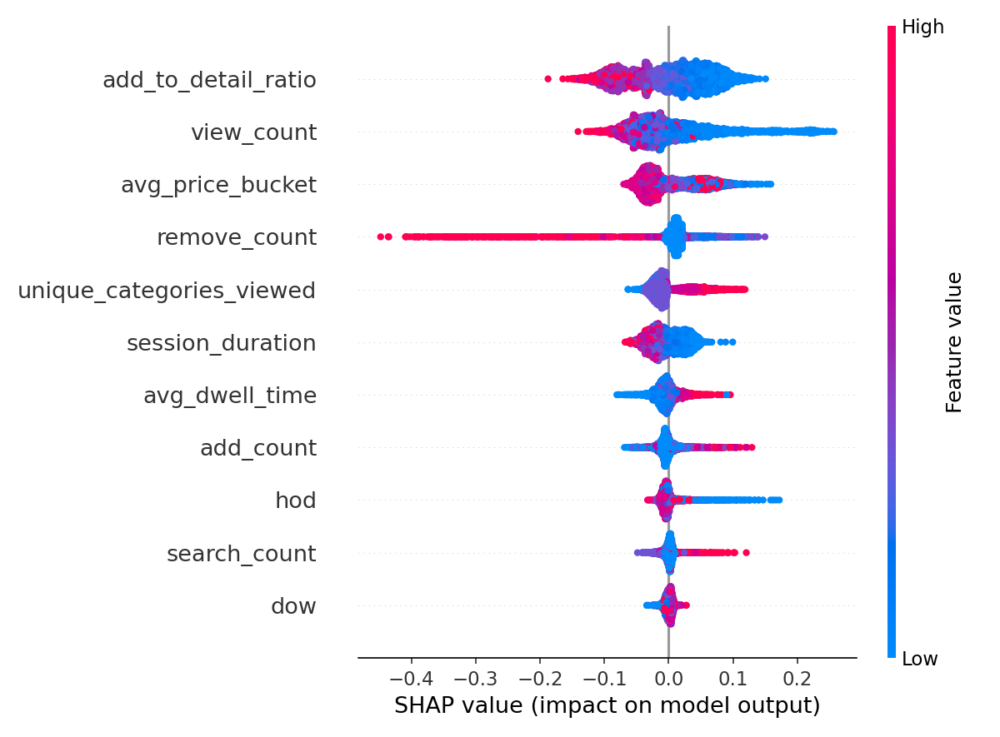
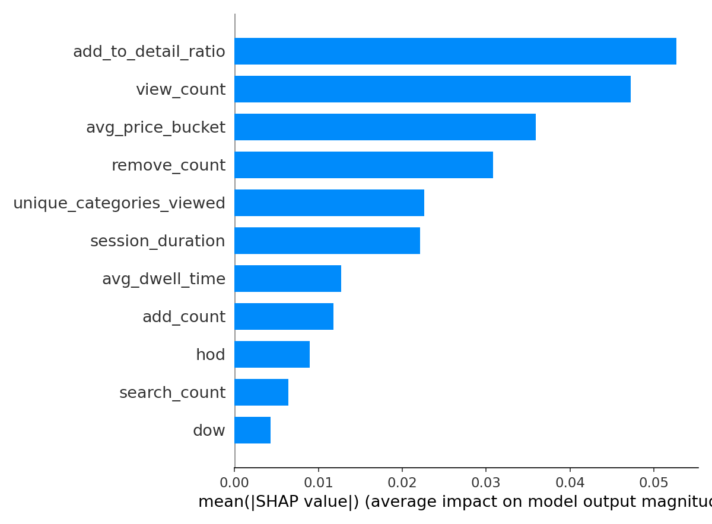
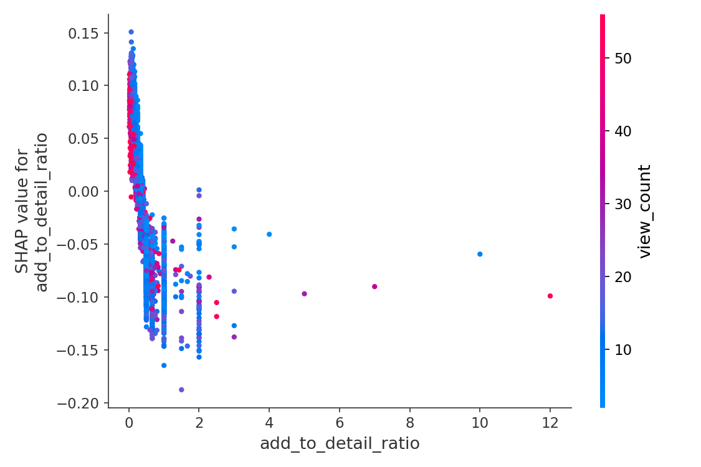

# Kết quả Case 1: Random Forest (Ngọc)

Bài toán: dự đoán xác suất bỏ giỏ P(SCA=1) từ 11 biến hành vi phiên. Trong tập train, SCA=1 chiếm 78,55%.

- **Mô hình:** Pipeline gồm `SimpleImputer(median)` rồi `RandomForestClassifier`. Xác suất lấy bằng `predict_proba[:, 1]`.
- **Dữ liệu:**
  - Train: `data/train_folds.csv`, 143.771 dòng.
  - Test: `data/test.csv`, 70.814 dòng.
  - Giữ nguyên dữ liệu: không chia lại, không xoá dòng.
- **Cross-validation (CV):** 10 fold theo cột `fold` (`PredefinedSplit`), seed 42.
- **Tuning:**
  - Thử ngẫu nhiên 30 cấu hình tham số.
  - Chọn cấu hình có RMSE trên xác suất thấp nhất.
  - Refit cấu hình đó trên toàn bộ tập train, rồi dự đoán test đúng một lần.
- **Biến:** `hod` và `dow` để nguyên dạng số, không biến đổi.
- **Code:** `notebooks/case1_rf_ngoc.py`, chạy trên Kaggle CPU.
- **Nguồn số liệu:** `../random_forest_ngoc.json` và các file trong thư mục này.

## 1. Metric chính trên test (tính trên xác suất)

| | RMSE ↓ | MSE | MAE | R² | ROC-AUC ↑ |
|---|---|---|---|---|---|
| Baseline (luôn đoán 0,7855) | 0,41051 | 0,16852 | 0,33704 | 0,0000 | 0,5000 |
| **Random Forest** | **0,37929** | **0,14386** | **0,29123** | **0,14631** | **0,75692** |

So với baseline, Random Forest giảm RMSE 7,61% và tăng AUC thêm 0,257.

**Độ ổn định**

| | RMSE | ROC-AUC |
|---|---|---|
| CV 10-fold (mean ± std) | 0,37915 ± 0,00070 | 0,7578 ± 0,0026 |
| OOF (toàn bộ train) | 0,37915 | 0,7577 |
| Test | 0,37929 | 0,7569 |

Kết quả trên CV và trên test gần như trùng nhau, không có dấu hiệu overfit.

## 2. Metric phân loại (chỉ tham khảo, phụ thuộc ngưỡng)

p\* = 0,69 là ngưỡng tối đa macro-F1 trên dự đoán OOF của train. Ngưỡng này không chọn trên test.

| Ngưỡng | Precision 1 | Recall 1 | F1 1 | Precision 0 | Recall 0 | F1 0 | Balanced acc. | Macro-F1 | Accuracy |
|---|---|---|---|---|---|---|---|---|---|
| 0,50 | 0,8042 | 0,9787 | 0,8829 | 0,6207 | 0,1274 | 0,2114 | 0,5531 | 0,5472 | 0,7961 |
| p\* = 0,69 | 0,8552 | 0,8289 | 0,8419 | 0,4370 | 0,4861 | 0,4602 | 0,6575 | 0,6510 | 0,7554 |

PR-AUC = 0,9186 (không phụ thuộc ngưỡng).

- **Ở ngưỡng 0,5:** mô hình gần như luôn đoán "bỏ giỏ" và chỉ bắt được 12,7% số phiên mua (lớp 0).
- **Ở ngưỡng p\*:**
  - Recall lớp mua tăng lên 48,6%.
  - Macro-F1 tăng từ 0,547 lên 0,651.
  - Đổi lại, recall lớp bỏ giỏ giảm từ 97,9% xuống 82,9%.

## 3. Tuning

**Không gian tìm kiếm**

| Tham số | Giá trị |
|---|---|
| `n_estimators` | 200, 300, 500 |
| `max_depth` | None, 10, 15, 20, 30 |
| `min_samples_leaf` | 1, 5, 10, 20, 35, 50 |
| `min_samples_split` | 2, 10, 20 |
| `max_features` | sqrt, 0.3, 0.5, 0.7, 1.0 |
| `class_weight` | None, balanced_subsample |

**Tham số tốt nhất (cand 16):**

- `n_estimators=500`, `max_depth=20`
- `min_samples_leaf=5`, `min_samples_split=20`
- `max_features=0.3`, `class_weight=None`

**Top 5 cấu hình** (bảng đầy đủ: `cv_results.csv`)

| cand | n_est | max_depth | leaf | split | max_features | RMSE CV | AUC CV |
|---|---|---|---|---|---|---|---|
| **16** | 500 | 20 | 5 | 20 | 0.3 | **0,37915** | 0,7578 |
| 06 | 500 | 20 | 20 | 20 | sqrt | 0,37929 | 0,7582 |
| 07 | 500 | 20 | 20 | 10 | 0.7 | 0,37929 | 0,7571 |
| 05 | 300 | 15 | 10 | 20 | sqrt | 0,37941 | 0,7584 |
| 04 | 300 | 30 | 35 | 20 | 0.5 | 0,37942 | 0,7572 |

**Nhận xét**

- **Hiệu năng chạm "mặt phẳng".**
  - 15 cấu hình tốt nhất có RMSE CV nằm trong khoảng 0,3791–0,3800, cách nhau chỉ cỡ 1 độ lệch chuẩn giữa các fold.
  - Vì vậy không nên diễn giải giá trị cụ thể của từng tham số tối ưu.
- **Cây quá nông hoặc quá sâu đều kém hơn.**
  - `max_depth=10` cho RMSE từ 0,3813 trở lên.
  - `max_depth=None`, hoặc `min_samples_leaf=1`, cho RMSE từ 0,3799 đến 0,3824.
- **`class_weight="balanced_subsample"` làm hỏng hiệu chỉnh xác suất.**
  - 10 cấu hình có cân lớp đạt RMSE 0,401–0,452.
  - 20 cấu hình không cân lớp đạt RMSE 0,379–0,383.
  - AUC của hai nhóm vẫn tương đương: 0,744–0,758 so với 0,746–0,758.
  - Nghĩa là cân lớp gần như không đổi khả năng xếp hạng, nhưng kéo xác suất dự đoán lệch xuống. RMSE đo trên xác suất nên bị phạt nặng.

**Thời gian chạy (Kaggle CPU)**

- Cấu hình tốt nhất fit trung bình 207 giây mỗi fold.
- Refit trên toàn bộ train mất 59 giây.
- Toàn bộ quá trình tuning mất khoảng 340 phút thực tế.
- `total_fit_time_s = 69.613` trong `tune_info.json` là tổng thời gian fit của mọi fold. Các fold chạy song song nên số này lớn hơn thời gian thực tế.

## 4. Độ quan trọng của biến

| Hạng | Mean \|SHAP\| (lớp SCA=1) | Impurity importance |
|---|---|---|
| 1 | add_to_detail_ratio (0,0527) | view_count |
| 2 | view_count (0,0472) | session_duration |
| 3 | avg_price_bucket (0,0359) | avg_dwell_time |
| 4 | remove_count (0,0308) | remove_count |
| 5 | unique_categories_viewed (0,0226) | add_to_detail_ratio |
| 6 | session_duration (0,0221) | |
| 7 | avg_dwell_time (0,0127) | |
| 8 | add_count (0,0118) | |
| 9 | hod (0,0090) | |
| 10 | search_count (0,0064) | |
| 11 | dow (0,0043) | |

- SHAP tính bằng `TreeExplainer` trên 5.000 dòng train lấy ngẫu nhiên (`random_state=42`). Giá trị SHAP ở thang xác suất.
- Impurity importance thiên vị các biến liên tục có nhiều giá trị khác nhau, như `session_duration` và `avg_dwell_time`. Vì vậy báo cáo nên dùng thứ hạng theo SHAP.
- Bảng impurity đầy đủ ở `feature_importance.csv`.

## 5. File trong thư mục này

| File | Nội dung |
|---|---|
| `cv_results.csv` | 30 cấu hình: tham số, RMSE và AUC từng fold, thời gian fit |
| `tune_info.json` | Cấu hình tốt nhất, p\*, metric OOF, thời gian |
| `oof_pred.csv` | Xác suất OOF của cấu hình tốt nhất trên toàn bộ train |
| `test_pred.csv` | Xác suất dự đoán trên test |
| `test_metrics.csv` | Metric test của RF và của baseline |
| `feature_importance.csv` | Impurity importance |
| `model.joblib`, `cv_parts/` | Model và checkpoint CV. Không commit vì file nặng; chạy lại script để tạo lại |
